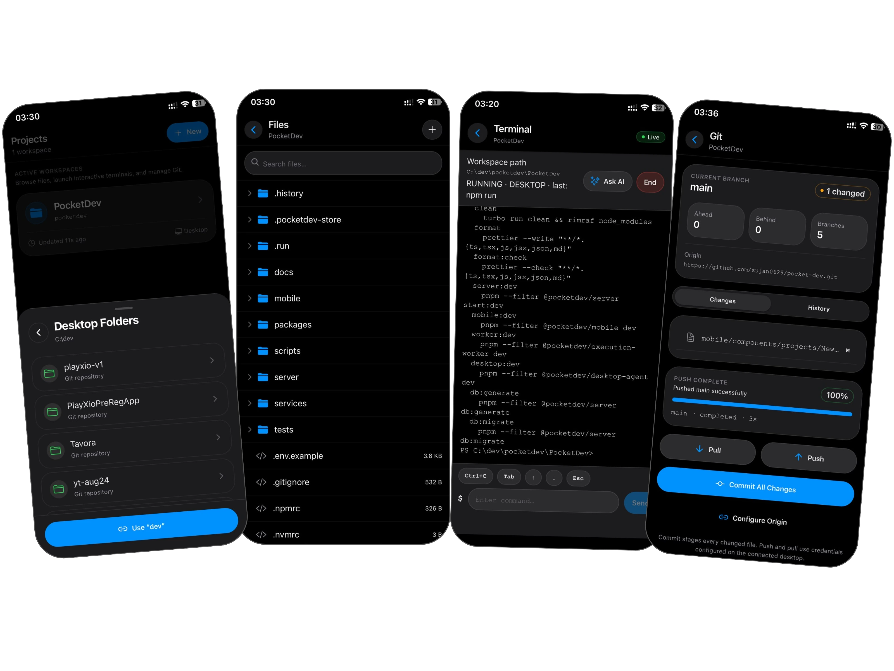

# PocketDev

**Browse code. Edit files. Run a real terminal. From your phone.**

PocketDev is a native mobile development workspace for your own desktop or a self-hosted execution worker. Sync a project, edit it on iOS or Android, run commands, and review or commit changes without opening a laptop.



[Set up locally](#try-it-locally) · [Mobile guide](mobile/README.md) · [Architecture](#how-it-works) · [Contribute](CONTRIBUTING.md)

## What you can do

- **Work in a real terminal:** interactive PTY sessions, streamed output, keyboard controls and cancellation.
- **Keep code moving:** watch a local folder and sync changes through the CLI agent; browse and edit files from the phone.
- **Choose where commands run:** use a connected desktop, or the cloud worker for synced projects. Cloud execution needs a running server and worker; powering off the desktop does not make the phone execute the project locally.
- **Handle Git from mobile:** inspect status and diffs, read history, commit, pull and push using the configured runtime credentials.
- **Ask about terminal output:** use a server-side AI provider, or optionally import a compatible GGUF model for on-device explanations. Offline explanations do not make remote terminals work offline.

**Status:** working prototype with a native client and self-hosted backend. Bring your own infrastructure. There is no hosted public demo or published app-store download in this repository.

## Try it locally

Use **Node 22** (see `.nvmrc`), **pnpm 10.28.2**, and Docker with Compose. Native `node-pty` builds may need a C/C++ toolchain. The mobile client requires a custom development build; Expo Go is not sufficient.

```bash
git clone https://github.com/sujan0629/pocket-dev.git
cd pocket-dev
node scripts/prepare-local.mjs
pnpm install --frozen-lockfile
docker compose up -d
pnpm --filter @pocketdev/shared --filter @pocketdev/pty-core -r build
pnpm db:generate
pnpm db:migrate
pnpm --filter @pocketdev/server db:seed
```

The setup helper creates missing local environment files with a random JWT secret. Existing files are preserved. Compose starts **PostgreSQL and Redis only**, not the app. The seeded demo accounts are `free@pocketdev.dev` and `paid@pocketdev.dev`, password `password123`; use them only in local development.

Start these in separate terminals:

```bash
pnpm server:dev
```

```bash
pnpm worker:dev
```

```bash
pnpm mobile:dev
```

Follow the [mobile build guide](mobile/README.md) for a custom iOS or Android client. You need your own Expo/EAS project and signing configuration; the checked-in EAS project is not a shared public build service.

On a physical phone, select the development computer's LAN address in the connection screen, not `localhost`. Set `WORKER_WS_URL` in `server/.env` to an address the phone can reach, such as `ws://<computer-LAN-IP>:4100`. For remote hosting use HTTPS/WSS and configure authentication and network access before exposing services.

For sync, desktop execution, AI configuration and verification commands, see the [development guide](docs/DEVELOPMENT.md). Supported Git actions depend on the credentials available on the selected runtime.

## How it works

```text
Phone app  ── HTTP / WebSocket ──> NestJS API ──> PostgreSQL
                                      │
CLI sync agent ── file deltas ──────────┤
                                      │ BullMQ / Redis
                                      ▼
                              Execution worker ──> Docker session
Phone app  <──── PTY over WebSocket ────┘

Or: API selects an online desktop agent; the phone connects to its PTY gateway.
```

The API owns accounts, project metadata and queue submission. The worker executes sessions and publishes lifecycle events through Redis; it does not connect directly to PostgreSQL. A shared PTY gateway powers cloud and desktop sessions.

| Workspace | Responsibility |
| --- | --- |
| [`mobile`](mobile/) | Expo / React Native client, editor, terminal, Git and optional local AI |
| [`server`](server/) | NestJS API, Prisma, project storage and job reconciliation |
| [`services/execution-worker`](services/execution-worker/) | BullMQ consumer and Docker-backed terminal execution |
| [`services/desktop-agent`](services/desktop-agent/) | Host terminal gateway, folder linking and presence |
| [`services/cli-agent`](services/cli-agent/) | Watched-folder delta sync |
| [`packages/pty-core`](packages/pty-core/) | Shared PTY transport and flow control |
| [`packages/shared`](packages/shared/) | TypeScript contracts |

## Execution boundaries

The default Docker runtime is `runc`. Set `EXECUTION_RUNTIME=runsc` only on a host where gVisor is installed and configured. Runtime selection is implemented; that setting alone is not evidence of a verified gVisor deployment or secure public multi-tenancy. Firecracker, Kata and production networking alternatives in planning documents are not delivered runtime features.

Desktop mode executes commands on the selected host and depends on that host's permissions. Use trusted projects and an environment you control. Local Compose credentials and demo accounts are development conveniences.

## Contributing and project history

Start with [CONTRIBUTING.md](CONTRIBUTING.md). Report a reproducible issue or propose a small change before a large rewrite. The [project brief](PROJECT-BRIEF.md), [build plan](BUILD-PLAN.md) and [academic origin and team attribution](docs/ACADEMIC.md) remain available as background; source code and current workspace guides determine what is implemented.

**License:** no top-level open-source license is currently declared. A license decision needs the maintainers' agreement; existing third-party licenses still apply.
